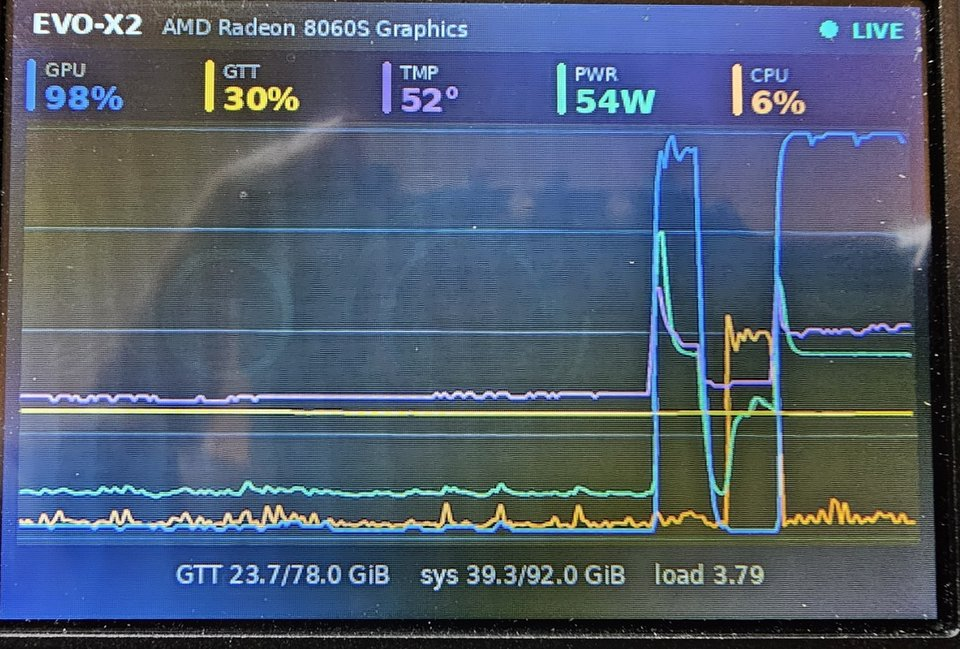
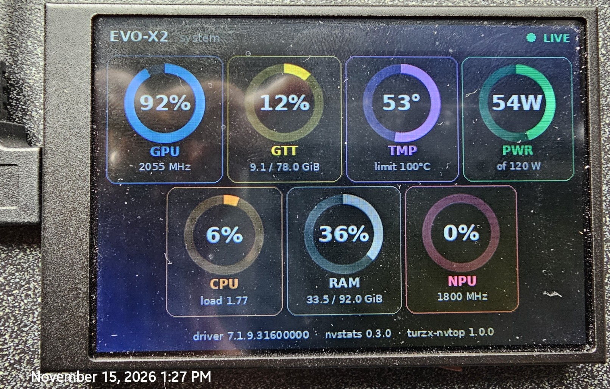

# turzx-nvtop

GPU/system stats on the **Turzx 3.5" USB LCD** (USB `1a86:5722`, a.k.a. "Turing Smart Screen" 3.5" rev A),
in the same style as [knvtop](https://github.com/DAE51D/knvtop) and [onvtop](https://github.com/DAE51D/openchamber-onvtop).
It is a client of [nvstats-service](https://github.com/DAE51D/nvstats-service) and is otherwise self-contained:
its own USB-serial driver, no third-party screen library, no pyserial.

<p align="center">
  
  
</p>

Screens (rotating; order and durations configurable):

| Screen | Shows |
| --- | --- |
| `graph`  | GPU / GTT / TMP / PWR / CPU history lines with live values (default 15 s) |
| `gauges` | six ring gauges: GPU, GTT, TMP, PWR, CPU, RAM (default 5 s) |
| `llm`    | running llama.cpp / Ollama / vLLM / SGLang / TGI engines (off by default: add it to `order` under `[screens]`) |


## Turzx 3.5 USB LCD

You can [find these](https://www.ebay.com/sch/i.html?_nkw=3.5%20Inch%20Type%E2%80%91C%20IPS%20Secondary%20Screen%20320*480%20USB&_sacat=0&_sop=15) on eBay for $20 or so. [This is a nice kit](https://www.ebay.com/itm/145206664084?var=444390238227) too.


## Smoothness

The graph scrolls continuously: every point is placed by the time it arrived (`px_per_second`), so lines glide
at 2 fps between samples instead of jumping once per sample (`refresh_seconds` under `[graph]`; 0.25 is smoother, but the panel repaints top to bottom and the ripple becomes visible). nvstats-service samples once a second by default;
for livelier numbers run it with `./install.sh --http --poll 0.5` (nvstats-service 0.3.0 or newer).

## How it stays fast

The panel takes ~1.8 s for a full frame and repaints top to bottom. So each screen is rendered in memory,
compared with a shadow copy of what the panel shows, and only the changed rectangles are sent. Steady state is
roughly 500-2000 pixels and 20-40 ms per update, so the graph can scroll smoothly at 2 frames a second. A screen
*switch* is a near-full repaint (~1.6 s), which is why switches are slow and visible.

## Requirements

- Linux with Python 3 (written to the 3.8 feature level, developed on 3.14), plus Pillow and numpy
  (`apt install python3-pil python3-numpy`, `dnf install python3-pillow python3-numpy`, or `pip install pillow numpy`).
- A running [nvstats-service](https://github.com/DAE51D/nvstats-service) **0.2.2 or newer with HTTP enabled**:
  `./install.sh --http` in that repo. This installer cannot do that for you, but it checks and tells you if it is missing.
- No distro-specific code: it talks to `/dev/ttyACM*` with plain termios.

Tested on Kubuntu 26.04 with an AMD Ryzen AI Max+ 395 (nvstats-service 0.3.0, user-service mode). Written for but **not yet
tested**: `--system` mode, distros that use the `uucp` group, and NVIDIA GPUs (nvstats supports them; this client only
displays what it is given).

## Install

```sh
git clone https://github.com/DAE51D/turzx-nvtop.git && cd turzx-nvtop
./install.sh                                   # user service + udev rule + sleep hook (asks for sudo for those)
sudo ./install.sh --system --run-as USER       # headless host: system service
```

The udev rule (`packaging/70-turzx-lcd.rules`, installed to `/etc/udev/rules.d/`) does three things:

- gives the display a stable name, `/dev/turzx-lcd`;
- grants access to whoever is logged in at the machine (`uaccess`), so no group membership is needed on a desktop.
  Headless or system-service use goes through the serial group instead (`dialout`, or `uucp` on Arch-family distros;
  the installer picks the one your distro has);
- tells ModemManager to leave the port alone. It otherwise probes it with AT commands, which the panel parses as
  drawing commands and can wedge until re-plugged.

The file name matters: it has to sort before `73-seat-late.rules` (applies `uaccess`) and `77-mm-*.rules`
(ModemManager), which is why it starts with `70-`. Only the rule is needed? `./install.sh --udev-only`, then re-plug.

**Unplugging is fine.** The daemon logs it once, waits quietly, and redraws as soon as the display is back.

**Sleep, hibernate and shutdown blank the display.** The panel is usually still powered over USB while the host is
asleep or off, and left alone it would show one static image for hours, which burns in. So:

- the installer adds a systemd sleep hook (`/usr/lib/systemd/system-sleep/turzx-nvtop`, a root-owned copy of
  [packaging/turzx-nvtop-sleep](packaging/turzx-nvtop-sleep)). Before the machine sleeps or hibernates it tells the
  daemon to blank the panel and waits (at most 3 s) until it is dark; after waking it restores brightness and repaints;
- in user-service mode the installer also adds a small systemd drop-in for the four sleep services
  (`/etc/systemd/system/systemd-{suspend,hibernate,hybrid-sleep,suspend-then-hibernate}.service.d/turzx-nvtop.conf`,
  from [packaging/turzx-nvtop-sleep.conf](packaging/turzx-nvtop-sleep.conf)) that sets
  `SYSTEMD_SLEEP_FREEZE_USER_SESSIONS=0`. Without it systemd freezes your whole user session *before* it runs the hook,
  so the daemon cannot react and the panel stays lit. This setting is machine-wide, not specific to this display: user
  programs keep running until the hook finishes (the kernel still freezes everything just before the machine actually
  sleeps). Delete the drop-ins to restore systemd's default. A `--system` install does not need or install it, since that
  daemon is not part of a user session;
- stopping the service (shutdown, reboot, `systemctl stop`) blanks it too (`screen_off_on_exit = yes`, the default).

If the panel loses USB power during sleep, nothing is needed: it comes back when the host does. A crash or `kill -9` of
the daemon cannot blank the panel; `python3 -m turzx_nvtop off` does it by hand.

## Troubleshooting

| Symptom | What to try |
| --- | --- |
| Screen stays blank right after plugging in | Wait a few seconds; it repaints after a short settle delay. Still blank: `python3 -m turzx_nvtop sync`, then restart the service. |
| `NO DATA` in the corner | nvstats-service is not running or has no HTTP. `curl http://127.0.0.1:8039/health` should answer; see its README. |
| Upside down | `rotation = 180` under `[display]`. |
| `permission denied` on `/dev/turzx-lcd` | Re-plug after installing the rule. On a box with nobody logged in at the console, add the service user to `dialout` (or `uucp`). |
| Garbled or shifted pixels | Run `python3 tests/hw_striptest.py` and see [docs/protocol](docs/protocol) (write framing). |
| Display stays lit while the host sleeps | The sleep hook or the systemd drop-in is missing: run `./install.sh` again, then check `ls -l /usr/lib/systemd/system-sleep/turzx-nvtop` and `systemctl show systemd-suspend.service -p Environment` (should list `SYSTEMD_SLEEP_FREEZE_USER_SESSIONS=0` in user mode). The log says `going to sleep: blanking the display` when it fires. |
| Logs | `journalctl --user -u turzx-nvtop -f` (or without `--user` for a system install). |

## Configure

`~/.config/turzx-nvtop/config.ini` (or `/etc/turzx-nvtop/config.ini`); see [config.example.ini](config.example.ini).
Upside down because of your cable? `rotation = 180` under `[display]` (or `--rotate 180`). Landscape only.

## Commands

```sh
python3 -m turzx_nvtop --version
python3 -m turzx_nvtop                 # run in the foreground (-v prints pixels/rects/ms per frame)
python3 -m turzx_nvtop preview gauges out.png [--demo]   # render a screen to PNG, no hardware needed
python3 -m turzx_nvtop sync | on | off # recover a wedged panel / screen on / off
python3 -m unittest discover -s tests  # unit tests
python3 tests/hw_striptest.py          # framing torture test on the real panel
```

## Protocol notes

Reverse-engineering notes are in [docs/protocol](docs/protocol). Key rules: a command is its own write, pixel
data goes out in multiples of 64 bytes, and never kill the writer mid-frame without running `sync` after
(the daemon does this at start).
